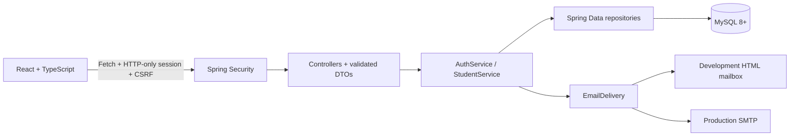
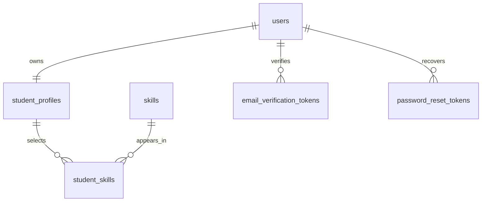

# Module 1 architecture

The frontend is a static Vite bundle and can run on Vercel independently of Java. Real business logic and persistence reside in Java. `AuthContext` switches to a fictional sample only after explicit demo entry and only when `VITE_DEMO_MODE=true`. API failures never choose the demo.

- Unique normalized email, registration number, and profile user ID prevent duplicate accounts/profiles.
- `student_skills(student_id,skill_id)` is a composite primary key; `student_id` references the **profile** ID.
- Tokens store SHA-256 hashes, not the raw secret. Purpose-specific tables and pessimistic locks prevent replay during concurrent requests.
- User rows carry timestamps, role, verification and account status, plus `credential_version`. Password changes increment the version; stale session principals are rejected on the next request.
- Core details contribute 60% profile completion; bio +15, location +10, skills +15. This is derived from stored profile fields.
- A student controls only their own profile. Email and registration number remain immutable through this module. Initials are used as the avatar; the nullable schema avatar column reserves future storage without an unsafe arbitrary URL/upload API.
- Only skills are seeded. No real students, earnings, jobs, reviews, partnerships, or testimonials are invented.

## Extension points

Add future `job`, `application`, `payment`, and `notification` packages to the same monolith, with their own controllers, DTOs, services, and migrations. Reference `users.id`; do not depend on frontend demo identifiers. Keep authorization in the Java request/service boundary.

## Operational scope

This is a single-instance classroom application. Sessions and rate counters are in memory. Email is synchronous; production mail delivery needs correctly configured SMTP. Multi-instance production would need shared sessions/limiting, operational monitoring, token-retention cleanup and an email outbox/retry policy. Development email HTML must remain private and ignored. No production mailbox endpoint exists.
