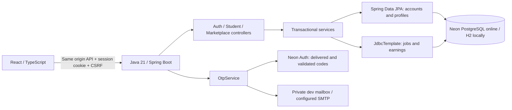

# JAVAC architecture

`backend/.../main/JavacApplication.java` is the actual Java entry point. `frontend/src/main/main.tsx` is the actual browser entry point. The root Dockerfile compiles React and includes its assets in the Java JAR. The same Java origin serves frontend routes and APIs; Vite uses an API proxy during development.

The top-level database/migrations directory is packaged by Maven and applied with Flyway. Production uses its own `javac_secure` schema; old presentation tables in public are not trusted as verified identities. PostgreSQL is preferred online; local H2 makes the Java project easy to run without installing MySQL.

Accounts use salted PBKDF2 hashes. Verification and recovery codes expire in five minutes, have a five-attempt cap, a resend cooldown and one-time consumption. Failed attempts commit in their own transaction. Local code hashes are salted; managed codes are validated by Neon Auth. The development mailbox is excluded from production and from version control.

The designated admin must prove email ownership and log in; admin permissions are checked in Java against the configured email. Suspension changes the account's credential version, invalidating existing sessions. Production sessions are persisted in PostgreSQL with Spring Session JDBC; cookies are Secure, HTTP-only and SameSite=Lax. CSRF protection remains enabled.

Job acceptance and state transitions acquire a row lock. Participant identity and lifecycle rules are checked server-side. Messages are restricted to the job's owner/helper; completed and cancelled conversations are read-only. Job searches are parameterized and paginated. Reviews require a completed job, target the other participant, and are unique per reviewer/job.

An agreed reward becomes earned only after requester-confirmed completion. Only the helper can record receipt of offline payment, and only once. That event is self-reported, not independently verified and not a money transfer.

## Limits

The app is a classroom project, not a formally audited payment or identity platform. Real Neon Auth delivery, production schema/session behavior, container availability and the complete deployed flow must be tested before promoting the secure build. The request rate limiter is currently bounded per Java instance; OTP attempt and cooldown state is shared in the database. Scale-wide login throttling and operational monitoring need review for a larger public rollout.
